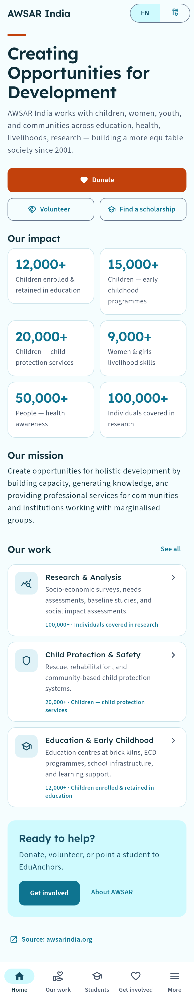
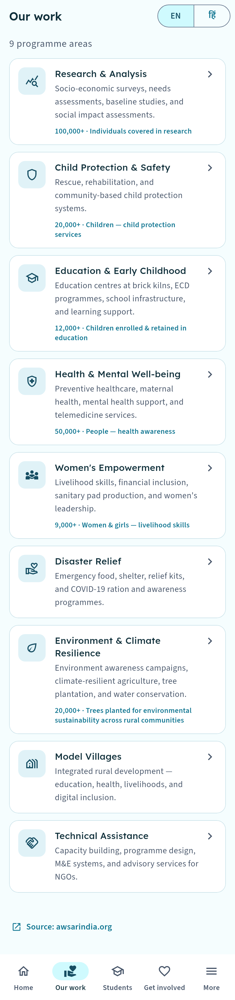
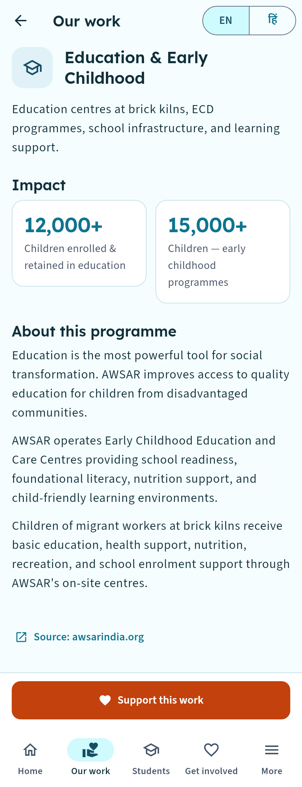
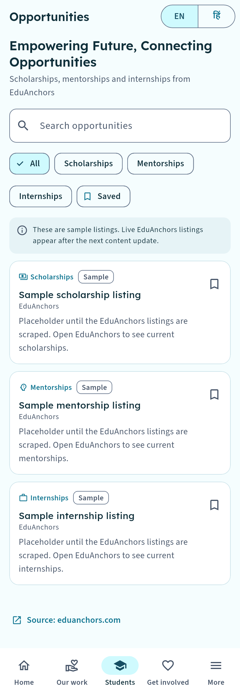
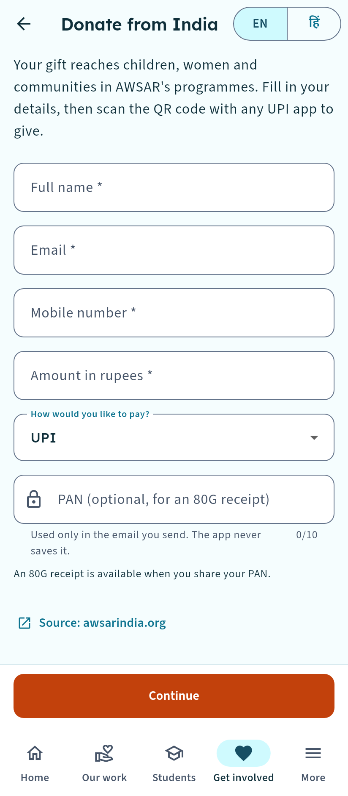
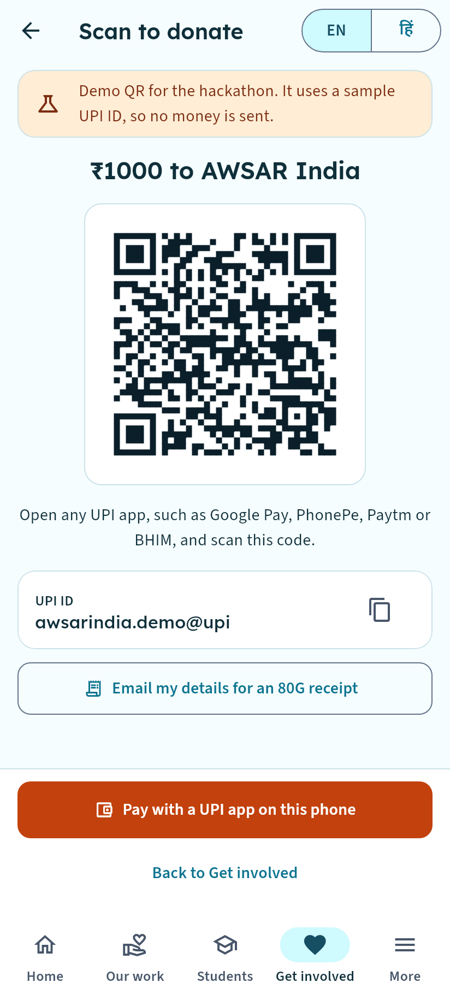
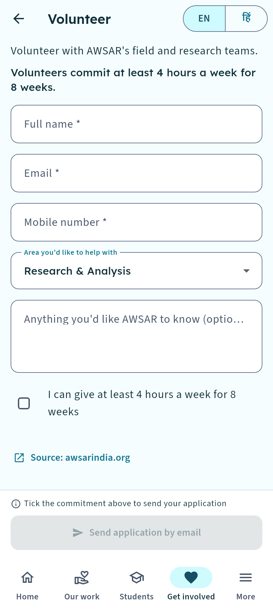
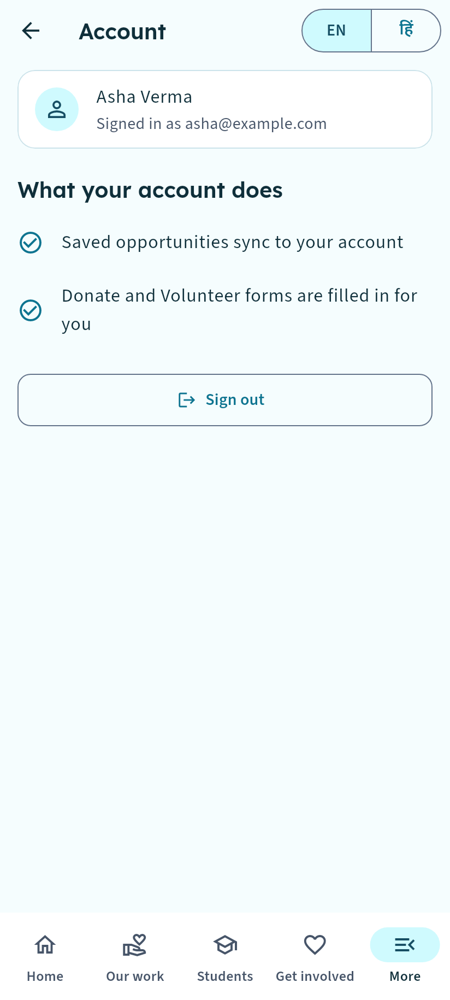
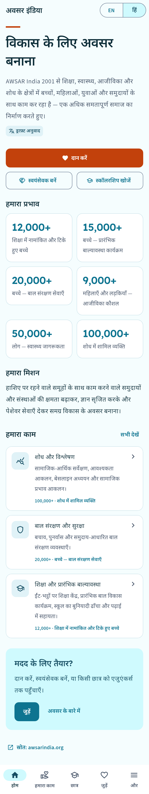
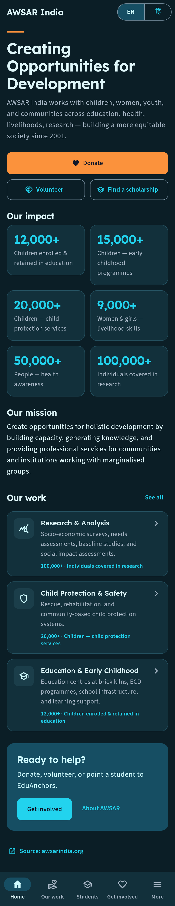

# AWSAR + EduAnchors

**An Android app that brings AWSAR India's work, EduAnchors' student opportunities, and ways to give into one bilingual app.**

Built with Flutter by **Team Zeroes and Ones** for **FOSS Forge 2.0**.


---

## The problem

AWSAR India runs programmes in child protection, education, health, women's empowerment and more. Its student arm, EduAnchors, offers scholarships, mentorship and internships. Today a donor, volunteer or student has to piece this together across two websites that aren't built for a phone, and only in English.

## What the app does

| | |
|---|---|
| 🏠 **Home** | AWSAR's mission, impact numbers and quick links to give or volunteer |
| 🤝 **Our work** | All 9 programmes, each with its description and impact stats from awsarindia.org |
| 🎓 **Students** | EduAnchors scholarships, mentorship and internships, with search, filters and a saved list |
| ❤️ **Donate (India)** | A short form, then a **UPI QR code** for the exact amount, plus an email option for an 80G tax receipt |
| 🌍 **Donate (abroad)** | FCRA-compliant guidance for gifts from outside India |
| 🙋 **Volunteer** | Choose an interest area and commitment, then send an application by email |
| 👤 **Account** | Optional sign-in. Saved opportunities sync across devices, and forms fill themselves in |
| 🌐 **English / हिंदी** | Switch the whole app between English and Hindi at any time |
| 📴 **Offline-first** | All content ships with the app, so every screen works without internet |
| ♿ **Accessible** | Passes Android accessibility guidelines and has no overflow at 2× text size in both languages |

## Screenshots

| Home | Our work | Programme | Opportunities |
|---|---|---|---|
|  |  |  |  |

| Donate | UPI QR | Volunteer | Account |
|---|---|---|---|
|  |  |  |  |

| हिंदी | Dark theme |
|---|---|
|  |  |

Every screen in every variant is in [`screenshots_test/goldens/`](screenshots_test/goldens/).

> **Demo note:** the donate QR uses the placeholder UPI ID `awsar.demo@invalid`, which no bank can issue, so no money can move. The screen labels it as a demo. To go live, set AWSAR's real UPI ID in `assets/content/*/donate.json` and set `"demo": false`.

## Tech stack

| Layer | Choice |
|---|---|
| App | Flutter 3.47, Dart 3.13, Material 3 |
| State | Riverpod 3 |
| Navigation | go_router (5-tab shell with deep links) |
| Languages | Flutter gen-l10n with ARB files (English, Hindi) |
| Content | Bundled JSON per language, with an English fallback for each file |
| Accounts | Supabase email and password auth, with row-level security on the saved list |
| Storage | shared_preferences for the language choice and saved items on the phone |
| Payments | UPI deep link and QR (`qr_flutter`). The app never handles money itself |
| Design | UI-UX Pro Max design system: Lexend and Source Sans 3, Noto Sans Devanagari for Hindi |

More detail in [`docs/architecture.md`](docs/architecture.md).

## Getting started

You need Flutter 3.47 or newer, Android Studio (with the Android SDK, command-line tools and NDK), and an Android phone with USB debugging or an emulator.

```bash
git clone https://github.com/<your-username>/<this-repo>.git
cd <this-repo>
flutter pub get
flutter run
```

That runs the full app offline, with sign-in switched off.

### Turn on sign-in (optional)

1. Create a free project at [supabase.com](https://supabase.com).
2. In **SQL Editor**, run [`supabase/migrations/20261021000000_saved_opportunities.sql`](supabase/migrations/20261021000000_saved_opportunities.sql). It creates the `saved_opportunities` table, where each user can only see and change their own rows.
3. In **Authentication → Sign In / Providers → Email**, turn **Confirm email** off for a demo so new accounts sign in straight away. Turn it back on for real users.
4. Copy `supabase.example.json` to `supabase.json`, then fill in the **Project URL** and the **publishable** key from **Project Settings → API Keys**. Never use the secret key. `supabase.json` is git-ignored.
5. Run with the keys:

```bash
flutter run --dart-define-from-file=supabase.json
```

### Build an APK

```bash
flutter build apk --release --dart-define-from-file=supabase.json
```

The APK is saved at `build/app/outputs/flutter-apk/app-release.apk`.

Setting up on Windows? [`docs/windows-setup.md`](docs/windows-setup.md) covers the common fixes: SDK paths with spaces, the missing NDK, and Xiaomi phones blocking USB installs.

## Tests

```bash
flutter analyze
flutter test
```

The 78 tests cover:
- content parsing in both languages, and English/Hindi string parity
- every tab and the language switch
- form validation and the donate QR and UPI link
- sign in, sign up and sign out against a fake backend
- merging the saved list between the phone and the account
- accessibility guidelines at 2× text size on every screen

Regenerate the screenshots with `flutter test screenshots_test`.

## Project structure

```
lib/
  app/            theme, router, 5-tab shell
  core/
    auth/         Supabase accounts (switched off when no keys are given)
    content/      content models and the repository
    links/        opening email, phone, web and UPI links
    widgets/      shared UI pieces
  features/       home, programmes, opportunities, get_involved, account, about, settings
  l10n/           app_en.arb, app_hi.arb
assets/content/   bundled content: en/ and hi/
supabase/         database migration with row-level security
test/             unit and widget tests
screenshots_test/ screenshot generator and the images it makes
design-system/    UI-UX Pro Max design tokens
```

## Privacy and security

- **PAN is never saved.** It only goes into the email the donor chooses to send for an 80G receipt.
- **Only the publishable key is in the app.** Database access is limited by row-level security, so one user can't read or change another user's saved items.
- **No payments inside the app.** Donors pay in their own UPI app.

## Content and status

- Programme and organisation text is quoted from [awsarindia.org](https://awsarindia.org) and [eduanchors.com](https://eduanchors.com), with a source link on every screen.
- The Hindi translation is a draft and is labelled as one in the app.
- The three opportunities are marked **Sample**. Photos, videos and reports stay empty until the site scraper is run.

## Team

**Team Zeroes and Ones**, FOSS Forge 2.0 (October 2026)
