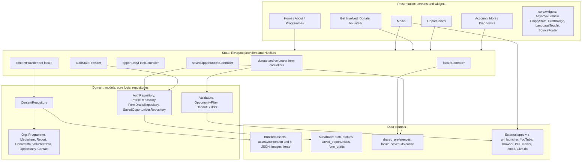

# AWSAR + EduAnchors: Flutter Android app architecture

Designed with ECC's architect agent (2026-10-21) from `.claude/prds/awsar-eduanchors-app.prd.md`, the Milestone 1 plan in `.claude/plans/awsar-eduanchors-app.plan.md` (rewritten for Flutter to match this doc), and `scripts/scrape-sites.mjs` (unchanged: a Node build-time tool).

---

## 1. Project description and traceability

**AWSAR** is an offline-first, bilingual (English/Hindi) Flutter app for Android. It brings AWSAR India's mission, nine programmes, media, donate and volunteer flows together with EduAnchors' scholarships, mentorships and internships, in one phone-first app. All content is scraped from the two public sites at build time and bundled as JSON assets. The Hindi is machine-translated at build time and labelled as a draft. Supabase is used only for login, saved opportunities and pre-filled forms. Payments are never processed in the app; it hands off to AWSAR's existing channels.

| # | Requirement (PRD) | App feature | Module(s) | Verified by |
|---|---|---|---|---|
| 1 | Mission, vision, values | About screen; mission line and hero on Home | `features/about`, `features/home`, `core/content` (Org) | Parsing test; checklist demo |
| 2 | Nine programme areas with impact | Programme cards, detail page with impact stats and images | `features/programmes` | Parsing test asserts exactly 9 with unique ids; router smoke test opens each detail page |
| 3 | Media: gallery, YouTube, annual reports (PDF) | Gallery grid, full-screen viewer, video list (opens the YouTube app), report list (opens the PDF externally) | `features/media`, `core/links` | Parsing test; tests that build the launch URLs; manual check on the phone |
| 4a | Donate within India: amount, payment preference, PAN for 80G, contact; hand off to the existing process or Give.do | Donate form, then handoff by email to AWSAR, Give.do, or AWSAR's donate page | `features/get_involved` (donate) | Validator unit tests (PAN, amount); mailto builder test; timed test (≤30 s) |
| 4b | Donate from outside India: FCRA route | International donation screen with FCRA text and details from the content | `features/get_involved` | Checklist demo |
| 4c | Volunteer form showing the 4 h/week for 8 weeks rule | Commitment card plus a required "I can commit" checkbox that gates submit | `features/get_involved` (volunteer) | Widget test: submit disabled until the box is ticked; 100% of testers finish |
| 5 | EduAnchors listings, browsable and filterable | List with type chips, search, deadline sort and "saved" filter; detail page | `features/opportunities` | Filter unit tests; timed test (≤45 s) |
| 6a | Login and sign up | Email and password through Supabase; unlocks saving and pre-filled forms | `features/account`, `core/supabase` | Manual test on a real project; RLS checked with SQL |
| 6b | EN/HI toggle switches the whole app instantly | Global locale controller; ARB UI strings plus per-locale content files | `core/l10n`, `core/content`, `app/app.dart` | ARB key-parity test; widget test that the toggle changes text |
| 7 | Offline | All content and images are bundled. Only login, save, video, PDF, Give.do and email need the network | `core/content`, `core/links`, `core/widgets/offline_notice` | Airplane-mode test from a fresh install |
| 8 | Bilingual quality | Bundled Noto Sans Devanagari; "Hindi draft, needs review by AWSAR" badge; Indian number formatting | `app/theme.dart`, `core/widgets/draft_badge` | `check-i18n.mjs` reports 0 missing; manual read of 3 screens |
| 9 | Reliability: cold start ≤3 s, no crash in 10 min | Content loads after the first frame, global error handlers, per-file English fallback, diagnostics screen | `main.dart`, `core/errors`, `features/settings` | `scripts/measure-cold-start.ps1` (median of 10); `adb shell monkey` run; 10-minute scripted demo |

---

## 2. High-level architecture

Four layers, organised by feature. Screens never touch `rootBundle`, Supabase or `url_launcher` directly. They go through providers, which call repositories and services.



**Folder strategy.** Content models live in `core/content/models` because a single repository loads them and several features read them (Home shows programmes, for example). Logic that belongs to one feature, such as form validation, filtering and the save repository, stays inside that feature under `domain/`, `data/`, `application/` and `presentation/`. A feature only gets the subfolders it needs, so the read-only content screens have just `presentation/`.

---

## 3. Folder and file tree

```
awsar_app/
├─ pubspec.yaml                      # deps, assets dirs, fonts, flutter.generate: true
├─ l10n.yaml                         # gen-l10n config: arb-dir lib/l10n, template app_en.arb, non-synthetic output, nullable-getter: false
├─ analysis_options.yaml             # flutter_lints + strict-casts, strict-raw-types, prefer_const, avoid_print
├─ env/
│  ├─ dev.json.example               # {"SUPABASE_URL": "...", "SUPABASE_ANON_KEY": "..."}; real dev.json/prod.json are gitignored
├─ android/
│  ├─ key.properties                 # gitignored; demo keystore credentials
│  └─ app/
│     ├─ build.gradle(.kts)          # applicationId org.awsarindia.app, release signingConfig from key.properties
│     └─ src/main/AndroidManifest.xml# INTERNET permission (release!), <queries> for https/mailto/tel, app label, launch theme colour
├─ lib/
│  ├─ main.dart                      # bootstrap: bindings, error handlers, prefs, guarded Supabase init, runApp(ProviderScope)
│  ├─ app/
│  │  ├─ app.dart                    # MaterialApp.router: locale from localeController, l10n delegates, theme
│  │  ├─ router.dart                 # GoRouter + StatefulShellRoute.indexedStack (5 branches), auth redirect, errorBuilder
│  │  ├─ routes.dart                 # route path constants and typed helpers (e.g. Routes.programme(id))
│  │  ├─ shell_scaffold.dart         # Scaffold + NavigationBar (5 tabs), keeps each tab's state
│  │  └─ theme.dart                  # Material 3 ThemeData, ColorScheme.fromSeed(brand), locale-aware TextTheme (Devanagari line height)
│  ├─ core/
│  │  ├─ config/env.dart             # String.fromEnvironment for SUPABASE_URL/ANON_KEY; isSupabaseConfigured
│  │  ├─ content/
│  │  │  ├─ content_repository.dart  # loads assets/content/<locale>/*.json, falls back to en per file, caches per locale
│  │  │  ├─ content_providers.dart   # contentProvider(locale) FutureProvider.family + typed selectors (programmesProvider, ...)
│  │  │  ├─ app_content.dart         # aggregate: org, programmes, media, reports, donate, volunteer, opportunities, contact + meta
│  │  │  ├─ content_meta.dart        # schemaVersion, locale, draft, generatedAt, fellBackToEnglish, skippedItems
│  │  │  ├─ json_read.dart           # helpers: reqStr/optStr/strList/objList with path-aware FormatException
│  │  │  └─ models/                  # org.dart, programme.dart, media_item.dart, report.dart, donate_info.dart,
│  │  │                              # volunteer_info.dart, opportunity.dart, contact.dart, content_image.dart, labeled_value.dart
│  │  ├─ l10n/locale_controller.dart # Notifier<Locale>: first launch = device locale if hi else en; persists to prefs
│  │  ├─ storage/prefs_provider.dart # sharedPreferencesProvider (overridden in main and in tests)
│  │  ├─ supabase/supabase_provider.dart # SupabaseClient? provider (null when not configured, so account features hide)
│  │  ├─ links/
│  │  │  ├─ link_launcher.dart       # wraps url_launcher (externalApplication); returns LaunchOutcome {ok, noApp, failed}
│  │  │  └─ mailto.dart              # builds mailto URIs with %20 encoding (not '+'), so bodies render correctly
│  │  ├─ errors/
│  │  │  ├─ error_reporter.dart      # in-memory ring buffer (last 50 errors, no PII), feeds the Diagnostics screen
│  │  │  └─ app_failure.dart         # sealed failure types: offline, auth, notFound, unknown, plus localized message keys
│  │  ├─ format/formatters.dart      # NumberFormat en_IN ₹ (lakh grouping), DateFormat per locale
│  │  └─ widgets/
│  │     ├─ async_value_view.dart    # one place for loading (skeleton) / error (retry) / empty / data states
│  │     ├─ empty_state.dart         # icon, message, optional action
│  │     ├─ error_state.dart         # friendly message, retry button, "details" in debug builds only
│  │     ├─ draft_badge.dart         # "Hindi draft, needs review by AWSAR" when locale is hi and meta.draft
│  │     ├─ source_footer.dart       # "Source: awsarindia.org/..." tappable credit on every content screen
│  │     ├─ language_toggle.dart     # EN | हिं segmented control in the app bar, with a semantic label
│  │     ├─ content_image.dart       # Image.asset with cacheWidth, errorBuilder placeholder, semanticLabel from alt
│  │     └─ offline_notice.dart      # snackbar or banner helper for actions that need the network
│  ├─ features/
│  │  ├─ home/presentation/
│  │  │  ├─ home_screen.dart         # mission line, 3 quick actions, programme carousel, opportunities teaser
│  │  │  └─ widgets/{quick_actions.dart, programme_carousel.dart}
│  │  ├─ about/presentation/
│  │  │  ├─ about_screen.dart        # mission, vision, values cards, history paragraphs
│  │  │  └─ contact_screen.dart      # address, tap-to-call or email, map link, socials
│  │  ├─ programmes/presentation/
│  │  │  ├─ programmes_screen.dart   # grid or list of the 9 programme cards
│  │  │  ├─ programme_detail_screen.dart # what it is, impact stats, images, source
│  │  │  └─ widgets/{programme_card.dart, impact_stat_tile.dart}
│  │  ├─ media/presentation/
│  │  │  ├─ media_hub_screen.dart    # 3 entries: Photos, Videos, Annual reports
│  │  │  ├─ gallery_screen.dart      # thumbnail grid (bundled 400px variants)
│  │  │  ├─ photo_viewer_screen.dart # full-screen PageView + InteractiveViewer (root navigator, no bottom bar)
│  │  │  ├─ videos_screen.dart       # bundled thumbnails; tap opens the YouTube app or browser
│  │  │  └─ reports_screen.dart      # year, title, size; tap opens the PDF URL externally
│  │  ├─ get_involved/
│  │  │  ├─ domain/
│  │  │  │  ├─ donation_request.dart # amount, preference, pan?, name, email, phone, address?, wants80G
│  │  │  │  ├─ volunteer_application.dart # name, email, phone, city, interests, availability, commitmentAccepted
│  │  │  │  ├─ validators.dart       # PAN regex ^[A-Z]{5}[0-9]{4}[A-Z]$, Indian mobile, email, amount > 0
│  │  │  │  └─ handoff_builder.dart  # pure: request -> mailto subject/body; also plain-text copy fallback
│  │  │  ├─ application/
│  │  │  │  ├─ donate_form_controller.dart    # pre-fill from profile + draft; saves draft without PAN
│  │  │  │  └─ volunteer_form_controller.dart # same pattern
│  │  │  └─ presentation/
│  │  │     ├─ get_involved_screen.dart       # Donate (India), Donate from outside India, Volunteer
│  │  │     ├─ donate_india_screen.dart       # short form, then handoff choices sheet
│  │  │     ├─ donate_international_screen.dart # FCRA route text + details from content
│  │  │     ├─ volunteer_screen.dart          # commitment card + form + gated submit
│  │  │     └─ widgets/{commitment_rule_card.dart, payment_preference_field.dart, handoff_sheet.dart}
│  │  ├─ opportunities/
│  │  │  ├─ domain/opportunity_filter.dart   # pure: type set, query, savedOnly, sort -> filtered list
│  │  │  ├─ data/saved_opportunities_repository.dart # Supabase CRUD + prefs cache of ids
│  │  │  ├─ application/
│  │  │  │  ├─ opportunity_filter_controller.dart  # Notifier<OpportunityFilter>
│  │  │  │  └─ saved_opportunities_controller.dart # AsyncNotifier<Set<String>>, optimistic toggle with revert
│  │  │  └─ presentation/
│  │  │     ├─ opportunities_screen.dart  # filter bar + list + result count
│  │  │     ├─ opportunity_detail_screen.dart # fields, "sample" label, apply link, save button
│  │  │     └─ widgets/{filter_bar.dart, opportunity_card.dart, save_button.dart}
│  │  ├─ account/
│  │  │  ├─ data/{auth_repository.dart, profile_repository.dart, form_drafts_repository.dart}
│  │  │  ├─ application/auth_controller.dart # StreamProvider of auth state; signIn/signUp/signOut
│  │  │  └─ presentation/
│  │  │     ├─ login_screen.dart     # sign-in / sign-up tabs; pops true on success
│  │  │     ├─ account_screen.dart   # profile fields (name, phone, city), sign out
│  │  │     └─ saved_screen.dart     # saved opportunities; unknown ids shown as "no longer listed"
│  │  └─ settings/presentation/
│  │     ├─ more_screen.dart         # menu: About, Media, Contact, Account, Language, Diagnostics
│  │     └─ diagnostics_screen.dart  # app version, content generatedAt, draft flag, fallback/skipped counts, error log
│  └─ l10n/
│     ├─ app_en.arb                  # template UI strings (with @descriptions and placeholders)
│     ├─ app_hi.arb                  # Gemini-translated at build time; same keys
│     └─ (generated app_localizations*.dart)
├─ assets/
│  ├─ content/
│  │  ├─ build_info.json             # generatedAt, scraper run date, counts (shown in Diagnostics)
│  │  ├─ en/{org,programmes,media,reports,donate,volunteer,opportunities,contact}.json
│  │  └─ hi/{same 8 files}            # same shape and ids; meta.draft = true
│  ├─ images/
│  │  ├─ brand/logo.png
│  │  └─ content/<hash>.jpg, <hash>_t.jpg # ≤1200px full + ≤400px thumbnail, made by build-content
│  └─ fonts/                         # NotoSans-{Regular,SemiBold}.ttf, NotoSansDevanagari-{Regular,SemiBold}.ttf, OFL.txt
├─ scripts/                          # Node build-time tools (package.json: playwright, sharp, Gemini SDK)
│  ├─ scrape-sites.mjs               # existing Playwright crawler -> scraped/pages.json, images/, pdfs/, manifest.json
│  ├─ build-content.mjs              # scraped -> assets/content/en/*.json + resized images; gaps -> content-reports/MISSING.md
│  ├─ translate-content.mjs          # Gemini: en -> hi for allow-listed text fields + app_en.arb -> app_hi.arb; batch + 429 retry
│  ├─ validate-content.mjs           # schema, en/hi id parity, non-text fields identical, assets exist, 9 programmes, https URLs
│  ├─ check-i18n.mjs                 # ARB key/placeholder parity + empty-string check; exits non-zero on any miss
│  └─ measure-cold-start.ps1         # adb force-stop + am start -W x10, prints median TotalTime
├─ content-reports/MISSING.md        # outside assets/ so it is never bundled
├─ supabase/migrations/0001_init.sql # tables, RLS, profile trigger (section 4)
└─ test/
   ├─ content/content_parse_test.dart       # parses every real asset file for en and hi; 9 programmes; 0 skipped; id parity
   ├─ l10n/arb_parity_test.dart             # same keys and placeholders in app_en.arb and app_hi.arb, no empty values
   ├─ app/router_smoke_test.dart            # pumps app with fake repos; visits every route incl. each programme id; no exceptions
   ├─ app/language_toggle_test.dart         # tap toggle -> tab label text changes to Hindi
   ├─ app/a11y_guidelines_test.dart         # meetsGuideline: androidTapTarget, labeledTapTarget, textContrast on 4 key screens
   ├─ get_involved/validators_test.dart     # PAN, phone, amount edge cases
   ├─ get_involved/handoff_builder_test.dart# mailto encoding (spaces as %20, Devanagari safe), PAN never in saved draft
   ├─ get_involved/volunteer_gate_test.dart # submit disabled until commitment accepted
   ├─ opportunities/opportunity_filter_test.dart
   └─ helpers/fakes.dart                    # in-memory repos, ProviderScope overrides
```

**Packages.** Use the latest stable version of each. Runtime: `flutter_riverpod`, `go_router`, `supabase_flutter`, `shared_preferences`, `url_launcher`, `intl`, plus `flutter_localizations` from the SDK. Dev: `flutter_lints`, `flutter_test`. That's it: seven runtime dependencies and no code generation beyond the built-in gen-l10n.

---

## 4. Data model

### JSON parsing: hand-written `fromJson` (decision)
- **Why:** there are about 10 small, read-only models. `json_serializable`/`freezed` need `build_runner`, which is slow and fragile on Windows (watch mode and file locks) and adds generated files to fix whenever the analyzer complains. Writing them by hand takes about 40 minutes in total, gives explicit defaults, and the parsing test proves them against the real assets.
- **How:** `core/content/json_read.dart` has helpers such as `reqStr(j, 'title', path)` and `optStr`, `strList`, `objList`. They throw `FormatException('programmes[3].title missing')` so errors point at the exact field.
- **Lenient at runtime, strict in tests.** At runtime a list parser skips a bad item and records it in `meta.skippedItems`, so one bad listing can't blank a whole screen. `content_parse_test` asserts that `skippedItems == 0` for the shipped content, so nothing is skipped silently.
- **Isolates:** the content is expected to be under 1 MB, so parse on the main isolate after the first frame. If the measured parse time is over about 16 ms, wrap it in `compute()`. Decide from the measurement, not ahead of time.

### Localized, draft and sourceUrl convention
- **One file per content type per locale, same shape:** `assets/content/{en,hi}/<type>.json` = `{ "meta": {...}, "items": [...] }` (or `"data": {...}` for singletons such as org, donate, volunteer and contact).
- `meta`: `{ schemaVersion: 1, locale: "hi", draft: true, generatedAt: ISO8601 }`. The DraftBadge shows when `locale == hi && meta.draft`. When AWSAR has reviewed a file, set `draft: false` for that file.
- **Stable `id`s (slugs) are shared across locales.** Saved opportunities and routes use ids, so switching language never breaks a link or a saved item.
- **Translatable vs verbatim fields.** `translate-content.mjs` translates only an allow-list of text fields per type (title, summary, body, etc.). It copies `id`, URLs, asset paths, numbers, dates, enums and proper nouns (AWSAR, EduAnchors, FCRA, PAN, 80G) unchanged. `validate-content.mjs` asserts that the verbatim fields are byte-identical between en and hi.
- **Every item carries `sourceUrl`**, shown by `SourceFooter`. EduAnchors items carry `sample: bool`, which is true only for illustrative listings and is shown as a "Sample" chip (the PRD's open question).
- **Fallback:** if a hi file is missing or invalid, the repository loads the en file for that content type, sets `meta.fellBackToEnglish`, and the screen shows a small "Showing English" note. The fallback is per file, not for the whole app.

### Dart models (fields; all immutable, `const` constructors, `fromJson` factories)
```dart
class ContentImage { final String asset; final String? thumbAsset; final String alt; }
class LabeledValue { final String label; final String value; }        // e.g. impact stats, bank details

class Org {
  final String mission; final String vision;
  final List<LabeledValue> values;        // value title -> description
  final List<String> aboutParagraphs; final ContentImage? hero; final String sourceUrl;
}
class Programme {
  final String id; final int order; final String title; final String summary;
  final List<String> body; final List<LabeledValue> impact;  // values kept as scraped strings
  final List<ContentImage> images; final String sourceUrl;
}
enum MediaKind { photo, video }
class MediaItem {
  final String id; final MediaKind kind; final String title; final String? caption;
  final ContentImage image;               // photo, or bundled video thumbnail
  final String? videoUrl;                 // youtube.com / youtu.be, opened externally
  final String sourceUrl;
}
class Report {
  final String id; final String title; final String? period;   // e.g. as written on site
  final String pdfUrl; final int? sizeBytes; final String sourceUrl;
}
class FcraInfo { final List<String> body; final List<LabeledValue> details; final String? paymentLinkUrl; }
class DonateInfo {
  final List<String> intro; final List<String> paymentPreferences;  // from the scraped form's options
  final String? taxNote;                  // 80G text as on site
  final String donatePageUrl; final String? giveDoUrl; final String? handoffEmail;
  final FcraInfo fcra; final String sourceUrl;
}
class VolunteerInfo {
  final List<String> intro; final int minHoursPerWeek; final int minWeeks;   // 4 and 8 per PRD
  final String commitmentText; final List<String> interestAreas;
  final String? formUrl; final String? handoffEmail; final String sourceUrl;
}
enum OpportunityType { scholarship, mentorship, internship }
class Opportunity {
  final String id; final OpportunityType type; final String title; final String? provider;
  final String summary; final String? eligibility; final String? amount;   // as written
  final DateTime? deadline; final String? location; final String? mode;
  final String? applyUrl; final List<String> tags; final bool sample; final String sourceUrl;
}
class Contact {
  final String? address; final List<String> phones; final List<String> emails;
  final String? mapUrl; final List<LabeledValue> socials; final String sourceUrl;
}
```
Every optional field is filled only from scraped text. Gaps go into `content-reports/MISSING.md` and are never invented. Suggested donation amounts, if used, are a UI constant, not content.

### Supabase schema and RLS (`supabase/migrations/0001_init.sql`)
```sql
create table public.profiles (
  id uuid primary key references auth.users(id) on delete cascade,
  full_name text check (char_length(full_name) <= 120),
  phone text check (char_length(phone) <= 20),
  city text check (char_length(city) <= 80),
  preferred_locale text not null default 'en' check (preferred_locale in ('en','hi')),
  created_at timestamptz not null default now(),
  updated_at timestamptz not null default now()
);

create table public.saved_opportunities (
  user_id uuid not null default auth.uid() references auth.users(id) on delete cascade,
  opportunity_id text not null check (char_length(opportunity_id) between 1 and 100),
  saved_at timestamptz not null default now(),
  primary key (user_id, opportunity_id)
);

create table public.form_drafts (
  user_id uuid not null default auth.uid() references auth.users(id) on delete cascade,
  form_type text not null check (form_type in ('donate','volunteer')),
  data jsonb not null default '{}'::jsonb
    check (jsonb_typeof(data) = 'object'
           and pg_column_size(data) < 8192
           and not (data ? 'pan')),          -- PAN is never stored server-side
  updated_at timestamptz not null default now(),
  primary key (user_id, form_type)
);

alter table public.profiles            enable row level security;
alter table public.saved_opportunities enable row level security;
alter table public.form_drafts         enable row level security;
revoke all on public.profiles, public.saved_opportunities, public.form_drafts from anon;

-- profiles: own row only
create policy profiles_select on public.profiles for select to authenticated using ((select auth.uid()) = id);
create policy profiles_insert on public.profiles for insert to authenticated with check ((select auth.uid()) = id);
create policy profiles_update on public.profiles for update to authenticated
  using ((select auth.uid()) = id) with check ((select auth.uid()) = id);

-- saved_opportunities: own rows; no update (toggle = insert/delete)
create policy saved_select on public.saved_opportunities for select to authenticated using ((select auth.uid()) = user_id);
create policy saved_insert on public.saved_opportunities for insert to authenticated with check ((select auth.uid()) = user_id);
create policy saved_delete on public.saved_opportunities for delete to authenticated using ((select auth.uid()) = user_id);

-- form_drafts: own rows; upsert needs insert + update
create policy drafts_select on public.form_drafts for select to authenticated using ((select auth.uid()) = user_id);
create policy drafts_insert on public.form_drafts for insert to authenticated with check ((select auth.uid()) = user_id);
create policy drafts_update on public.form_drafts for update to authenticated
  using ((select auth.uid()) = user_id) with check ((select auth.uid()) = user_id);
create policy drafts_delete on public.form_drafts for delete to authenticated using ((select auth.uid()) = user_id);

-- auto-create profile on sign-up
create function public.handle_new_user() returns trigger
language plpgsql security definer set search_path = '' as $$
begin
  insert into public.profiles (id) values (new.id) on conflict do nothing;
  return new;
end; $$;
create trigger on_auth_user_created after insert on auth.users
  for each row execute function public.handle_new_user();

-- updated_at maintenance
create function public.set_updated_at() returns trigger language plpgsql set search_path = '' as $$
begin new.updated_at = now(); return new; end; $$;
create trigger profiles_updated before update on public.profiles for each row execute function public.set_updated_at();
create trigger drafts_updated   before update on public.form_drafts for each row execute function public.set_updated_at();
```
`opportunity_id` deliberately has no foreign key, because the opportunities are bundled content, not database rows. The app shows unknown ids as "no longer listed".

**Check RLS before the demo:** in the SQL editor, sign in as user A and confirm that a select on user B's rows returns 0 rows.

---

## 5. Key flows

**App start (target ≤3 s cold, measured)**
1. `main()`: `WidgetsFlutterBinding.ensureInitialized()`. Set `FlutterError.onError` and `PlatformDispatcher.instance.onError` to send errors to ErrorReporter. In release builds, `ErrorWidget.builder` shows a friendly tile.
2. `SharedPreferences` instance (a few tens of ms), so the saved locale is known before the first frame and the language never flashes.
3. If `Env.isSupabaseConfigured`: `Supabase.initialize(url, anonKey)` wrapped in try with a 2 s timeout. It restores the saved session locally and needs no network. If it fails, the Supabase provider is null and the account UI shows "Accounts unavailable" while everything else works.
4. `runApp(ProviderScope(overrides: [prefs, supabase]))`. Android's launch theme (brand colour, logo) covers the gap, so no splash package is needed.
5. First frame: Home shows skeletons. `contentProvider(currentLocale)` loads the 8 asset files in parallel (`Future.wait`), and the other locale is preloaded straight afterwards so the toggle is instant. A `Stopwatch` logs "content ready in X ms" to Diagnostics, which gives a measured result.

**Language toggle**
1. Tap EN | हिं, which calls `localeController.set(hi)`. That updates state and writes to prefs (fire-and-forget).
2. `MaterialApp.router` rebuilds with `locale: hi`, so the ARB strings, Material widgets (via GlobalMaterialLocalizations) and TalkBack language all switch.
3. Screens watch `contentProvider(locale)`, which is already cached, so the switch happens in the same frame with no restart and the navigation stack is kept, because routes use ids.
4. The DraftBadge appears. If the user is logged in, `profiles.preferred_locale` is updated in the background.

**Donate handoff (India)**
1. Get Involved, then Donate (India). The form is pre-filled from the profile and the donate draft if the user is logged in. PAN is never pre-filled and never persisted.
2. The user enters amount, payment preference (options from the scraped form), PAN (validated only if 80G is wanted), name, email and phone. Validators run inline.
3. "Continue" opens a handoff sheet with three choices:
   - **Primary: "Send to AWSAR by email".** `mailto:` to `donate.handoffEmail` with a structured subject and body. This copies AWSAR's own process, where their form emails AWSAR and AWSAR replies with payment instructions.
   - **"Donate on Give.do".** Opens `giveDoUrl` externally.
   - **"Open AWSAR donate page".** Opens the existing site form.
4. If no email app is available (the launch result is `noApp`), the summary is copied to the clipboard and the donate page opens instead.
5. The draft (without PAN) is upserted to `form_drafts` if the user is logged in. The PRD's donation metric stops when the email compose screen or the payment link opens.
6. The international option goes to the FCRA screen: content text and details, plus the payment link if the content has one.
7. The default needs AWSAR to confirm they accept emailed donation requests. Until then, the site form stays one tap away.

**Volunteer submit (chosen default: prepared email to AWSAR, with the website form as secondary)**
1. The commitment card ("minimum 4 h/week for 8 weeks") is shown above the form. Submit stays disabled until the user ticks "I can commit to this".
2. Submit validates the form, then opens a `mailto:` to `volunteer.handoffEmail`, falling back to the contact email from the content, with all fields in the body. The draft is saved if the user is logged in, and a success screen shows "What happens next".
3. **Why this default:** it reaches a channel AWSAR actually reads today. A `volunteer_applications` table in Supabase was rejected because nobody at AWSAR would see it (there is no admin app), which would make the demo dishonest. POSTing to their website form was rejected because it is an undocumented endpoint (nonces, spam filters) and would send unsolicited submissions to a small NGO.

**Save opportunity**
- **Logged in:** tap the bookmark. The controller adds the id to state immediately (optimistic), then inserts into `saved_opportunities`. On failure the change is reverted and a snackbar says "Couldn't save, check internet". After each successful sync the id set is mirrored to prefs.
- **Logged out:** tap the bookmark to open a bottom sheet ("Log in to save opportunities"). `await context.push<bool>(Routes.login)`. If it returns `true`, the save goes ahead automatically, so the user doesn't have to tap again.
- **Saved tab:** reads the controller, which loads from prefs first and then refreshes from Supabase.

**Offline behaviour**
- Everything readable works from the first launch after install with no network, which is stronger than the PRD's "after first open". That covers all text, all bundled images, filters, forms and the toggle.
- Actions that need the network are attempted and fail gracefully, with no `connectivity_plus` pre-check. "Connected" doesn't guarantee internet, so the app relies on the result of the actual call.
  - Login and save: snackbar.
  - YouTube, PDF and Give.do: they open in another app, which shows its own offline state. The report tile also shows a "needs internet" hint.
  - `mailto`: email apps queue the message offline, so it still works.
- A Supabase session survives being offline. A failed token refresh doesn't sign the user out, and saved ids come from the prefs cache.

---

## 6. State, navigation, UI states, theming, fonts, images, accessibility

**State management: `flutter_riverpod` (decision).**
- `contentProvider` is a `FutureProvider.family<AppContent, Locale>`. Screens `ref.watch(contentProvider(ref.watch(localeProvider)))`, so a locale change re-selects the content with no glue code. Everything async gets the same loading, error and data handling through `AsyncValue`.
- `ProviderScope(overrides:)` lets `main` inject the prefs and Supabase client, and lets tests inject fakes without a mocking library.
- Use the current `Notifier`/`AsyncNotifier` APIs, not the legacy `StateNotifier`/`StateProvider`. No `riverpod_generator`, so no build_runner.
- **Rejected: `provider`.** It means ChangeNotifier plus FutureBuilder wiring, rebuilding by hand when the locale changes, and test overrides that depend on BuildContext.
- **Rejected: bloc.** Too much boilerplate for 24 hours.

**Navigation: `go_router` with `StatefulShellRoute.indexedStack`** (5 branches, each tab keeps its scroll position and stack).
- Home: `/`
- Programmes: `/programmes` → `/programmes/:id`
- Opportunities: `/opportunities` → `/opportunities/:id`
- Get Involved: `/get-involved` → `/donate`, `/donate/international`, `/volunteer`
- More: `/more` → `/about`, `/contact`, `/media`, `/media/photos`, `/media/videos`, `/media/reports`, `/account`, `/account/saved`, `/diagnostics`
- Root navigator, so the bottom bar is hidden: `/media/photos/view/:index` and `/login`.
- `redirect`: `/account/saved` and `/account` go to `/login?from=...` when signed out.
- Unknown ids, such as a stale link, go to a NotFound screen with a "Back to list" button. They never throw.
- **Rejected: Navigator 2.0 by hand** (too much code) and **auto_route** (needs code generation).

**Error, empty and loading states:** a single `AsyncValueView<T>` widget handles all of them.
- Loading: skeleton placeholders sized like the content, to avoid layout shift.
- Error: localized message plus Retry, which calls `ref.invalidate`.
- Empty: `EmptyState` with a context action, for example "Clear filters" on Opportunities.
- Every list screen needs all four states, and `flutter-reviewer` checks for them.

**Theming**
- Material 3, light theme only (dark theme rejected for time).
- `ColorScheme.fromSeed(seedColor: <AWSAR brand colour sampled from the scraped logo>)`. Don't guess the colour.
- Check that the seed-derived on-colours reach WCAG AA (4.5:1). `a11y_guidelines_test` enforces text contrast.
- One spacing scale (4/8/16/24). Cards use `FilledButton` for the primary action on each screen (Donate, Volunteer, Apply).

**Devanagari font handling**
- Bundle Noto Sans and Noto Sans Devanagari, both under the OFL; ship `OFL.txt`.
- `ThemeData(fontFamily: 'NotoSans', fontFamilyFallback: ['NotoSansDevanagari'])`. Mixed strings such as "AWSAR की योजना" then render correctly, with the same look on every OEM.
- For `hi`, `TextTheme.apply(heightFactor ≈ 1.15–1.25)` so the matras above and below the line aren't clipped.
- Avoid fixed-height text containers and `maxLines: 1` on Hindi titles. Use 2 lines plus ellipsis.
- **Rejected: `google_fonts`.** It fetches fonts at runtime unless you bundle them anyway, which breaks offline-first.

**Images**
- Everything is bundled. `build-content.mjs` uses `sharp` to produce a ≤1200 px full image and a ≤400 px thumbnail per image, at about 80% quality.
- Set an asset budget of about 15 MB and record the APK size as a measured result.
- `ContentImage` uses `Image.asset(cacheWidth: logicalWidth * devicePixelRatio)` to cap decode memory, with an `errorBuilder` placeholder. The Home hero image is precached.
- Video thumbnails are downloaded at build time, so the video list also works offline.
- **`cached_network_image` is not needed:** no runtime image comes from the network.
- **PDFs** open externally via `url_launcher` with the original `pdfUrl` (`LaunchMode.externalApplication`), which goes to Chrome or the system PDF viewer. Rejected: `syncfusion_flutter_pdfviewer` (licence, size) and `pdfx`/`flutter_pdfview` (native setup, adds a plugin and debugging time). Bundling large reports would also bloat the APK. Stretch goal: bundle the latest report and open it with an intent.
- **YouTube** opens externally in the YouTube app. Rejected: an embedded player (WebView plugin, blank-screen risk on some devices, no offline benefit).

**Accessibility**
- **Text scaling:** never clamp `textScaler` down. Test at 1.3× and 2.0×. Lists use flexible heights, and chips wrap with `Wrap`, not `Row`.
- **Semantics:**
  - Every `IconButton` has a `tooltip`, which also gives it a semantic label.
  - Images use the scraped `alt` as `semanticLabel`; decorative images use `excludeFromSemantics: true`.
  - The language toggle reads "Language: English. Switch to Hindi" and has the Hindi equivalent.
  - Impact stats are merged with `MergeSemantics`, so a stat reads as "1,200 students".
- **Tap targets:** at least 48 dp (Material default `MaterialTapTargetSize.padded`). Filter chips and the bookmark button are checked by `androidTapTargetGuideline`.
- **Contrast:** `textContrastGuideline` runs in the widget test. Errors use text and an icon, not colour alone.
- **TalkBack:** switching `MaterialApp.locale` also switches the speech language. Do a quick manual pass on Home and Donate with TalkBack on.

---

## 7. Build and quality

**Gates (run before every checkpoint):**
```
dart format --output=none --set-exit-if-changed .
flutter analyze                      # zero issues
flutter test                         # all green
node scripts/validate-content.mjs    # content schema + parity + assets
node scripts/check-i18n.mjs          # ARB parity, 0 missing
```

**Tests worth writing in 24 hours** (about 2 hours total, ordered by value):
1. `content_parse_test`: reads the real `assets/content/{en,hi}/*.json` from disk with `dart:io` and runs the production parsers. Asserts 9 programmes with unique ids, en/hi id parity, 0 skipped items, and that every `asset` path exists on disk. This catches most demo-breaking content bugs.
2. `arb_parity_test`: same key set and placeholder names in both ARB files, with no empty values. This is the PRD's "0 untranslated strings" metric as a test.
3. `router_smoke_test`: pumps `App` with fake repositories, `go()`es to every route including each programme and opportunity id plus one unknown id, `pumpAndSettle`, and expects `tester.takeException()` to be null.
4. `opportunity_filter_test`, `validators_test`, `handoff_builder_test` (mailto encoding, PAN absent from the draft map): pure functions, fast to write.
5. `language_toggle_test` and `volunteer_gate_test`: two small widget tests.
6. `a11y_guidelines_test`: `expectLater(tester, meetsGuideline(androidTapTargetGuideline))` and the same for `labeledTapTargetGuideline` and `textContrastGuideline` on Home, Opportunities, Donate and Volunteer. These are built into `flutter_test` and take about 10 minutes.

Skip golden tests (font and platform flakiness on Windows) and integration_test on the device. A scripted manual demo plus monkey covers the device side.

**Content pipeline:** `scrape-sites.mjs` → `build-content.mjs` → `translate-content.mjs` → `validate-content.mjs` + `check-i18n.mjs`. Commit `assets/content/**`, the ARB files and `scraped/pages.json`. Don't commit `scraped/images` or `scraped/pdfs`. `GEMINI_API_KEY` lives only in `scripts/.env` (gitignored) and is never read by Dart code.

**Secrets and config**
- Run and build with `flutter run --dart-define-from-file=env/dev.json` and `flutter build apk --release --dart-define-from-file=env/prod.json`.
- `env/*.json` is gitignored. `Env` reads `String.fromEnvironment`, and an empty value disables account features rather than crashing.
- The Supabase anon key is public by design, so RLS is the real protection. The `service_role` key must never be in the app or the repo.
- `/security-scan` before the release build should grep the APK's inputs for `service_role`, `GEMINI` and `AIza`.

**Android manifest gotchas (these cause most "works in debug, broken in release" failures):**
- Add `<uses-permission android:name="android.permission.INTERNET"/>` to `src/main/AndroidManifest.xml`. The template puts it only in the debug and profile manifests, so login silently fails in the release APK without it.
- Add a `<queries>` block with intents for `https` VIEW, `mailto` SENDTO and `tel` DIAL. Android 11+ package visibility makes `canLaunchUrl` return false without it. Better still: call `launchUrl` and handle its `false` result instead of relying on `canLaunchUrl`.

**Release APK for the demo**
- `keytool -genkey -v -keystore %USERPROFILE%\awsar-demo.jks -keyalg RSA -keysize 2048 -validity 10000 -alias awsar`. Put the credentials in a gitignored `android/key.properties` and wire `signingConfigs.release` in `android/app/build.gradle(.kts)`. This takes about 10 minutes, and any rebuilt APK then installs over the previous one.
- Fallback: the template's debug-signed release build is fine for sideloading but can't be published.
- Build a fat APK (`flutter build apk --release`) for the demo so ABI is never an issue. Also run `--split-per-abi` once and record the arm64 size as a metric.
- Install with `adb install -r build\app\outputs\flutter-apk\app-release.apk`.

**Supabase gotchas**
- Turn off "Confirm email" for the hackathon project, or pre-create the demo accounts. The built-in SMTP is heavily rate-limited and confirmation links need deep-link setup.
- Free projects pause after inactivity, so open the dashboard the morning of the demo.

**Windows setup gotchas (do all of this before the event)**
- `flutter doctor -v` must be clean for the Android toolchain. Install Android Studio with SDK Platform, Build-Tools and **cmdline-tools**, then run `flutter doctor --android-licenses`.
- Turn on **Windows Developer Mode**. Flutter needs symlink support to build plugins on Windows ("Building with plugins requires symlink support").
- Keep the project at a short path that isn't synced by OneDrive and has no spaces (e.g. `C:\dev\awsar_app`). Run `git config --global core.longpaths true`.
- Use the JDK bundled with Android Studio. If Gradle complains about the JDK, `flutter config --jdk-dir` points Flutter at it. A Windows Defender exclusion for the project folder and `%USERPROFILE%\.gradle` noticeably speeds up the first Gradle build, which is slow.
- On the phone: enable Developer options and USB debugging, and choose "File transfer" USB mode. Accept the RSA prompt and check `adb devices`. Install the Google USB driver or the OEM driver if the phone isn't listed. Some OEM skins (e.g. Xiaomi) need an extra "Install via USB" toggle.
- Allow installs from unknown sources for the file manager or browser used to sideload.
- Use `scrcpy` (FOSS) to mirror the phone to the projector and for screenshots and recordings.

**Measuring results (judges score this)**
- **Cold start:** `measure-cold-start.ps1` runs `adb shell am force-stop org.awsarindia.app; adb shell am start -W -n org.awsarindia.app/.MainActivity` 10 times and reports the median and maximum `TotalTime`. Run it on a release build.
- **Time to content:** the Stopwatch value in Diagnostics.
- **Crash resistance:** `adb shell monkey -p org.awsarindia.app --pct-syskeys 0 --throttle 200 -v 3000`. Report events run and crashes (target 0). Then a scripted 10-minute demo run.
- **Offline:** fresh install in airplane mode, then a full tour of the checklist.
- **Task timing:** app vs website on the same phone, with 3–5 people. Record seconds and taps for donate, scholarship and volunteer.
- **Hindi coverage:** `check-i18n` output (0 missing).

---

## 8. Architecture decisions (ADRs) and risks

| # | Decision | Rejected alternatives and why |
|---|---|---|
| 1 | Bundle all content as JSON assets, offline-first | Fetching from Supabase or a CMS at runtime (network dependency, needs an admin flow nobody asked for); WebView of the sites (the brief says "not a copy of the website") |
| 2 | Riverpod, no code generation | provider (manual async and locale wiring), bloc (boilerplate), riverpod_generator (build_runner on Windows) |
| 3 | go_router with StatefulShellRoute | Navigator 1 with tab IndexedStack by hand (deep links and redirect by hand), auto_route (code generation) |
| 4 | gen-l10n ARB for UI strings; separate per-locale JSON for content | A runtime JSON localizer (string keys, typos only found at runtime, no Material localizations); one JSON with `{en, hi}` per field (makes translating a whole file and per-file draft flags awkward) |
| 5 | Hand-written `fromJson` plus a strict parsing test | json_serializable/freezed (build_runner time and fragility for about 10 read-only models) |
| 6 | Gemini translation at build time only, flagged as draft | Translating at runtime (an API key in the APK, needs network, cost); hand translation (no time) |
| 7 | Handoff via `mailto`, Give.do and site links; no payments | Payment SDKs (FCRA and 80G compliance, out of scope); WebView with injected prefill (fragile, cross-origin); POSTing to the site's form (undocumented endpoint, spam risk) |
| 8 | Volunteer default: prepared email to AWSAR | Supabase table (nobody at AWSAR reads it); opening the site form only (user retypes everything) |
| 9 | PAN never persisted (server CHECK constraint plus client) | Storing PAN in form_drafts (sensitive identifier, no need for the demo) |
| 10 | Login is optional and degrades gracefully if Supabase is down or not configured | Login wall at start (hurts the timed tasks); Firebase Auth (a second backend; Supabase was already chosen) |
| 11 | PDFs and YouTube open externally | In-app PDF viewer (licence or plugin cost); embedded YouTube player (WebView flakiness) |
| 12 | Bundled Noto Sans and Noto Sans Devanagari | System fonts (differ by OEM); google_fonts (runtime fetch) |
| 13 | No connectivity_plus; handle real call failures | Pre-checking connectivity ("connected" isn't the same as "internet", and it's an extra plugin) |
| 14 | No crash-reporting SDK; in-app ring buffer plus Diagnostics screen | Sentry/Crashlytics (setup time, privacy notice, network at the demo) |

| Risk | L | I | Mitigation |
|---|---|---|---|
| Toolchain or Gradle failure on Windows mid-event | M | H | Prove hello-world on the phone and a signed release APK before the event; `dart-build-resolver` agent; keep the last good APK on the phone |
| Scraped structure is messy (programmes, EduAnchors fields) | H | H | Human review of `MISSING.md`; never invent; `sample: true` listings labelled in the UI; the validator blocks the build if there aren't 9 programmes |
| Hindi rendering (clipped matras, tofu glyphs) | M | M | Bundled Devanagari font, height factor, 2-line titles; manual read of 3 screens on the phone |
| Release-only failures (INTERNET permission, `<queries>`, R8) | M | H | Manifest checklist above; test the **release** APK, not just debug, by hour 12 |
| Supabase paused, rate-limited or email confirmation blocks login at the demo | M | M | Confirmation off, pre-created demo account, wake the project before the demo; app works fully without login |
| `mailto` handoff fails (no email app) or the target address isn't confirmed | M | M | Clipboard and site-form fallback; email only from scraped content; flag for AWSAR confirmation |
| APK bloat from images | M | L | sharp resize, thumbnails, about 15 MB budget, size recorded |
| Cold start over 3 s on a mid-range phone | L | M | Only prefs and Supabase init before `runApp`; content after the first frame; measure median of 10; `compute()` if parsing is slow |
| Scope creep with 24 h solo | H | H | Hour budget: 0–1 toolchain, 1–4 scrape, build and translate, 4–6 shell, router, l10n and theme, 6–8 Home, About and Programmes, 8–10 Media, 10–13 Get Involved, 13–16 Opportunities, 16–18 Account, 18–20 tests and a11y, 20–22 measurements and user tests, 22–24 buffer, release and rehearsal. If behind, cut stretch items first: dark mode, in-app PDF, profile editing |
| Content credit and permission | L | M | `SourceFooter` on every screen, credits in About, PRD open question raised with AWSAR |

---

## 9. ECC commands, skills and agents per part

| Part | Use |
|---|---|
| Milestone planning (milestones 2–7 from the PRD) | `/plan`, one Flutter plan per milestone that replaces the RN plan |
| Content pipeline scripts (build, translate, validate, check-i18n) | `/orch-add-feature`; `i18n-sync` skill for ARB and content parity rules |
| App shell, router, theme, l10n | `/orch-add-feature`; `dart-flutter-patterns` skill (Riverpod Notifier, go_router shell, gen-l10n); `frontend-design-direction` for the visual direction |
| Each feature (programmes, media, get_involved, opportunities, account) | `/orch-add-feature`, then `/flutter-test`, then `/flutter-review` (`flutter-reviewer` agent, `flutter-dart-code-review` skill) |
| Supabase schema and RLS | `database-migrations` skill for `supabase/migrations/0001_init.sql`; `/security-scan` for the RLS check, no service_role in the app, no Gemini key in assets |
| Polish and feel (spacing, skeletons, haptics, transitions) | `make-interfaces-feel-better` skill |
| Accessibility | `frontend-a11y` skill (text scaling, semantics, contrast, tap targets) plus the `meetsGuideline` widget tests |
| Bugs during the build | `/orch-fix-defect`; `dart-build-resolver` agent for analyzer, Gradle, plugin and signing errors |
| Builds | `/flutter-build` (debug on device, release APK with `--dart-define-from-file`) |
| Quality gates before each milestone is closed | `verification-loop` skill (format, analyze, test, validate-content, check-i18n, release build); `/code-review`; then `/checkpoint` |
| Final proof (milestone 7) | `verification-loop` plus the measurement scripts; `/security-scan` on the final tree; `/checkpoint` "demo-ready" |

**`/gan-design` and `ui-demo` don't fit a native app.** Both drive web pages through Playwright, and there is no web page for the Android app. Instead:
- **Design critique:** capture real device screenshots with `adb exec-out screencap -p > shot.png` (or `flutter screenshot`, or scrcpy) in English and Hindi at 1.0× and 2.0× text scale. Have Claude review the images against the `frontend-design-direction`, `make-interfaces-feel-better` and `frontend-a11y` checklists, then apply fixes through `/orch-fix-defect`.
- **Demo recording:** `adb shell screenrecord /sdcard/demo.mp4` or scrcpy's `--record`, instead of `ui-demo`.
- `flutter run -d chrome` with `/gan-design` is possible for a rough layout pass only. Fonts, platform widgets and `url_launcher` behaviour differ from Android, so its results don't count as evidence for the native app.